<p align="center">
  
</p>

<h1 align="center">에이전트 탭은 이제 닫아도 돼요.</h1>

<p align="center">
  할 일을 채팅 하나에 한꺼번에 적으면 Ondra가 작업으로 나눠 동시에 돌려요.<br>
  내가 골라야 할 게 생기면 그때 묻고, 다 했다고 하기 전에 직접 확인해요.
</p>

<p align="center">
  <a href="https://github.com/3x-haust/ondra/releases"><b>macOS용 다운로드 ↗</b></a> · <a href="#설치">설치 안내</a> · <a href="README.md">English</a>
</p>

<p align="center"><sub>macOS 13 이상 · Apple silicon</sub></p>

<p align="center">
  <a href="https://3x-haust.github.io/ondra/#film">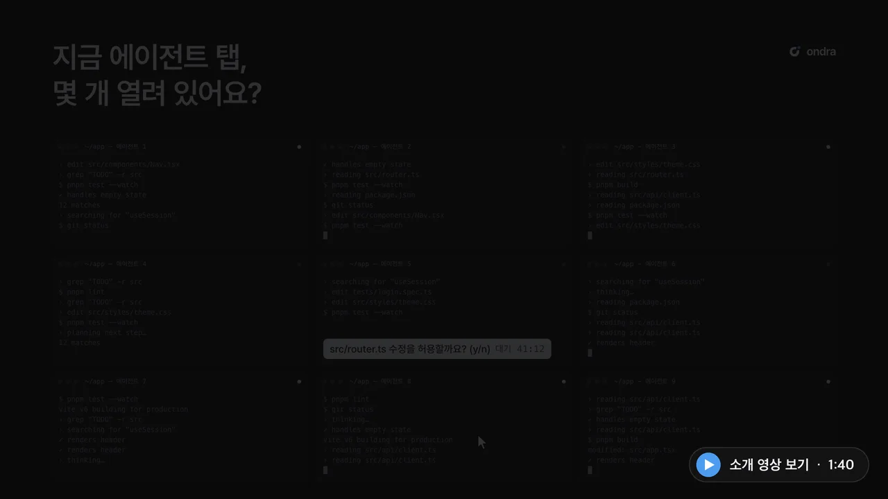</a>
</p>

<p align="center"><sub><a href="https://3x-haust.github.io/ondra/#film">전체 영상 보기 (1분 40초) ↗</a> · 영상 속 Ondra 화면은 모두 실제 앱에서 녹화했어요.</sub></p>

<br>

## 채팅 하나면 돼요

탭은 닫으세요. 모든 일을 메인 대화 하나에 말하면 돼요. 프로젝트마다 대화도 따로 있어서, 거기서 맡긴 일은 그 프로젝트 폴더에서 진행돼요.

<p align="center">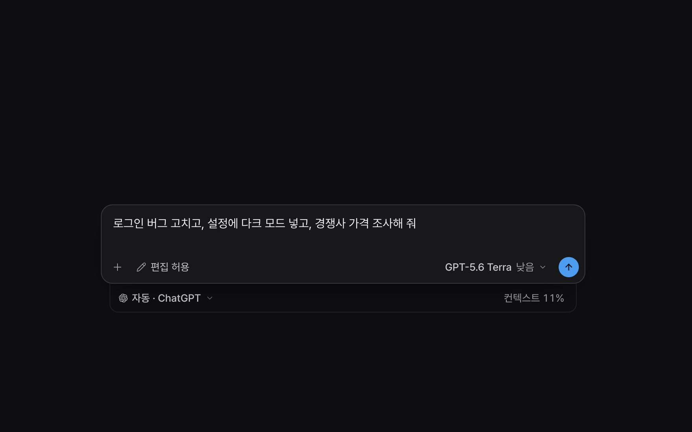</p>

## 일은 작업으로 나눠서 동시에

메인이 요청을 작업으로 나누고, 작업마다 맡은 부분을 끝까지 진행해요. 캔버스에서는 메인, 프로젝트, 작업, 서브에이전트가 어떻게 이어지는지, 각 작업이 지금 뭘 하는지 볼 수 있어요.

<p align="center">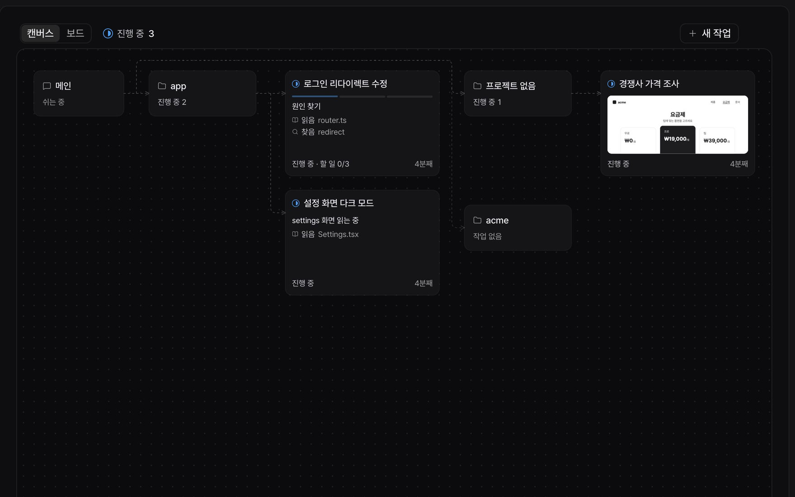</p>

<details>
<summary>세션과 컨텍스트는 알아서 챙겨요</summary>

- **작업별 세션:** 작업마다 대화를 나눠요. 작업별 워크트리를 켜면 Git 변경 사항을 다른 작업이나 내가 쓰는 폴더와 분리할 수 있어요.
- **이어가기:** 긴 작업은 완료한 일, 발견한 내용, 다음 단계와 증거를 새 세션에 넘겨요. 끝난 작업에 더 요청하거나 진행 중 방향을 바꾸면, 앞선 결과를 이어받는 새 작업이 시작돼요.
- **캐시 재사용:** 공통 지침과 계정 선택은 프롬프트 캐시를 재사용할 수 있도록 구성해요. 실제 캐시 사용은 모델과 제공자에 따라 달라요.

</details>

## 내가 정할 일만 물어봐요

의도나 취향이 필요한 순간에만 맥락과 선택지를 함께 보여줘요. 번호나 Enter를 누르거나 직접 답을 적으면 돼요. 진행 중인 작업에 들어가 방향을 바꿀 수도 있어요.

<p align="center">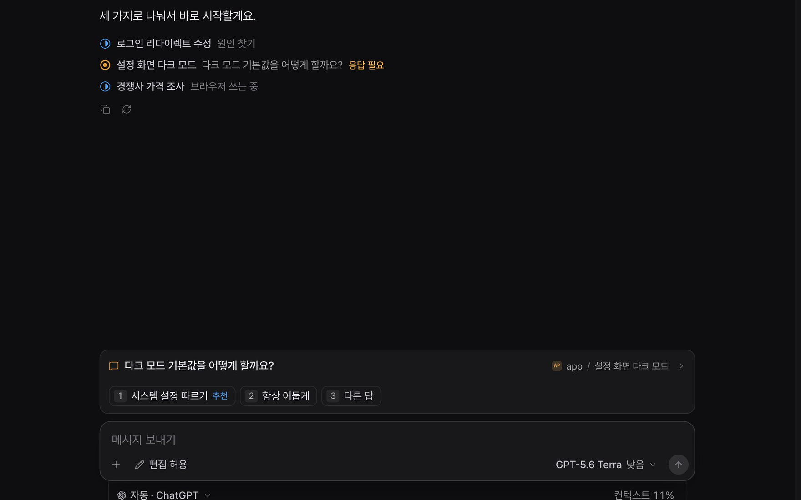</p>

## 다 했다고 하기 전에 실제 앱에서 써 봐요

앱을 바꾼 작업은 자기 앱 사본을 띄워서 바뀐 부분을 직접 써 봐요. 본 화면은 스크린샷과 로그로 남기고, 확인하지 못한 건 따로 표시해요. 프로젝트를 확인하는 방법은 한 번만 스킬로 적어 두고(`.agents/skills/check-<이름>/`), 다음 작업부터 그대로 써요.

<p align="center">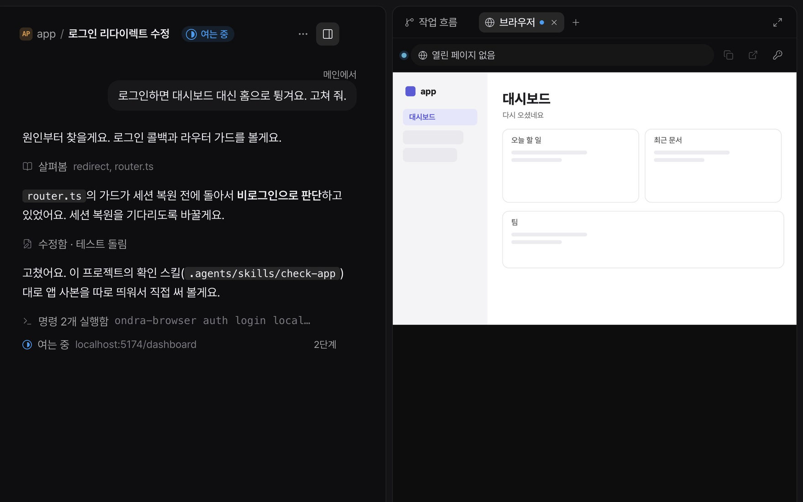</p>

<details>
<summary>결과와 함께 오는 것</summary>

- **말보다 결과:** 계획, 바뀐 파일과 diff, 전후 화면, 영상, 테스트 결과로 보여줘요. HTML 결과물, 표, 체크리스트와 그림도 패널에서 열어볼 수 있어요.
- **기록과 대조:** 완료 보고에 붙은 명령 실행과 파일 등의 증거를 작업 기록과 맞춰 봐요. 확인되지 않은 항목은 따로 표시해요.
- **필요한 검토:** 복잡하거나 민감한 변경은 계획과 코드 리뷰로 살펴볼 수 있어요. 검토 과정은 작업 범위와 프로젝트 지침을 따라요.
- **확인은 이어서:** 통과한 검사는 그 범위의 코드가 바뀌기 전까지 이어서 써요. 배포했다는 이유만으로 같은 검사를 반복하지 않아요.
- **켜고 끄기:** 앱에서 직접 확인하는 건 기본으로 켜져 있어요. 설정의 *작업 끝나면 앱에서 직접 확인*에서 끌 수 있어요.

</details>

## 작업마다 자기 브라우저

작업마다 자기 탭에서 웹을 살펴보고 조작해요. 같은 워크스페이스에서는 로그인 상태를 함께 쓰고, 비밀번호는 macOS 키체인이 넣어서 모델에는 보이지 않아요. 다른 일을 하면서 작업의 브라우저를 구석 작은 창으로 지켜볼 수 있어요.

<p align="center">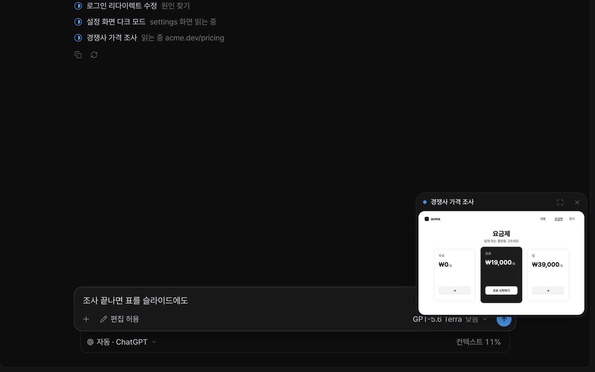</p>

## 컴퓨터 사용

권한을 허용하면 작업이 Mac 앱을 뒤에서 써요. 앱에 직접 동작을 보내기 때문에 내 커서와 앞에 띄운 앱은 그대로예요. 결과는 그 앱의 창을 캡처해서 확인해요.

<p align="center">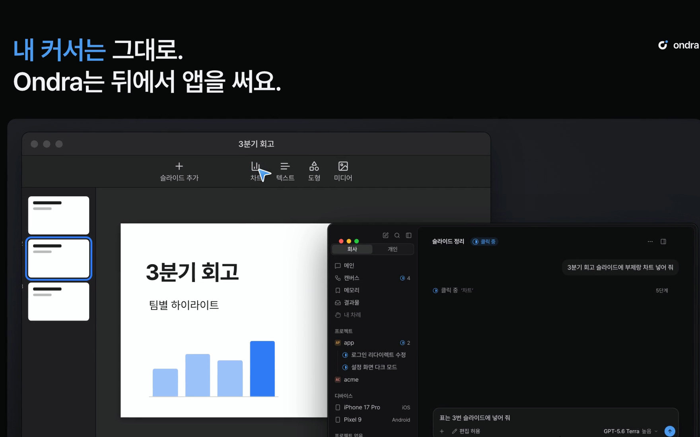</p>

## 시뮬레이터와 에뮬레이터

플랫폼 도구를 설치하면 작업이 iOS 시뮬레이터와 Android 에뮬레이터로 모바일 앱을 확인하고 화면을 남겨요. Ondra 안에서 기기 화면을 보고 직접 조작할 수도 있어요.

<p align="center">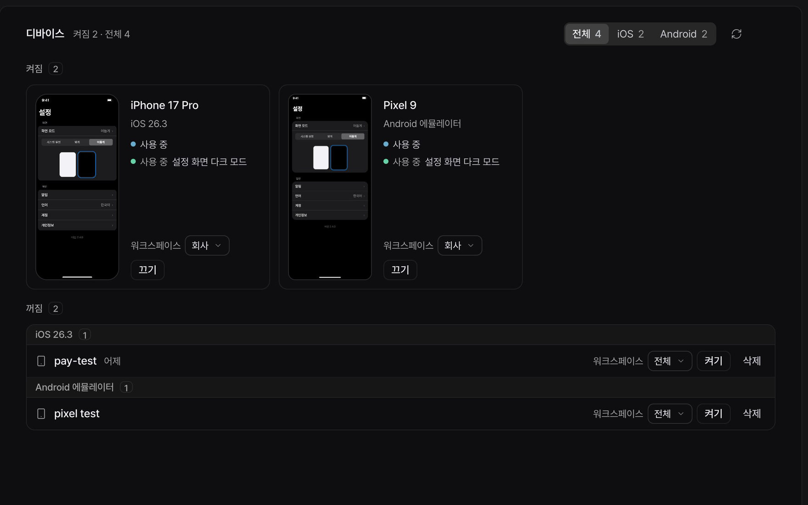</p>

## 출처가 붙은 조사

딥리서치는 질문을 나눠 출처를 읽고, 인용이 원문과 맞는지 확인해요. 답은 출처가 붙은 보고서와 PDF로 받아요.

<p align="center">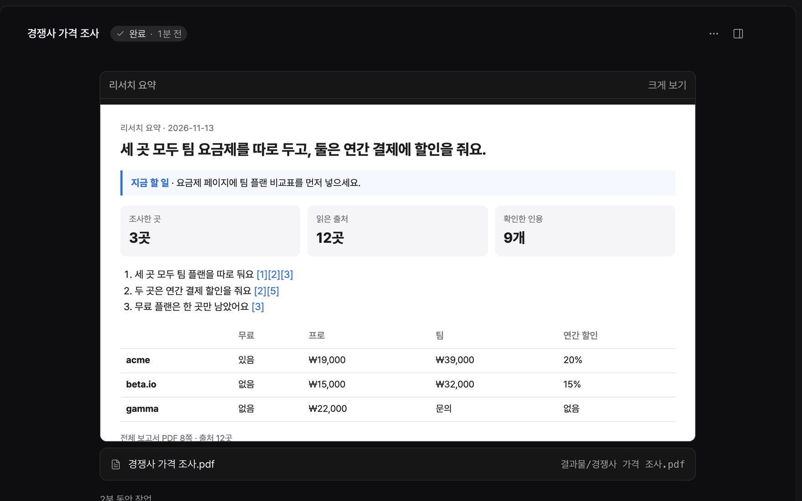</p>

## 합칠지는 내가 정해요

자기 워크트리에서 일한 작업이 바뀐 파일을 남기고 끝나면, 합칠지 PR로 올릴지 버릴지 물어봐요. 화면이 바뀌지 않는 버그·성능 수정은 다 확인됐으면 묻지 않고 합치고, 같은 답을 세 번 연속 고르면 그 프로젝트는 다음부터 묻지 않아요. 메모리에 적힌 게 늘 먼저예요. 작업이 만든 것은 결과물에 모여요.

<p align="center">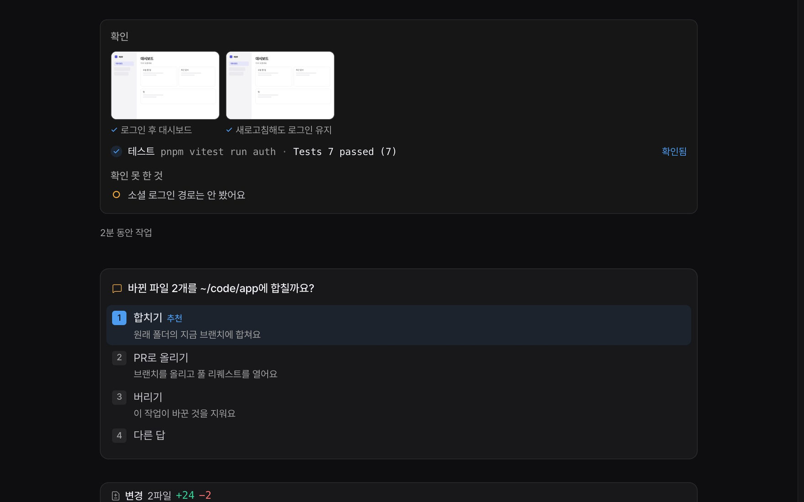</p>

<details>
<summary>PR도 작업과 함께</summary>

GitHub 계정을 연결하면 PR 상태, 검사, 리뷰와 바뀐 파일을 작업 옆에서 볼 수 있어요. 리뷰 코멘트를 작업에 넘기거나, 스크린샷과 영상을 PR에 첨부할 수도 있어요.

푸시와 PR 변경에는 GitHub 쓰기 권한이 필요해요. 새 리뷰, 실패한 검사와 충돌에 작업이 대응하게 하려면 설정에서 리뷰 자동 대응을 켜세요.

</details>

## 말로 부족하면 그려서

답 안에서 단계별로 그림을 그리고, 돌려 볼 수 있는 3D 모델을 만들고, 차트와 다이어그램, 슬라이드로 정리해요.

<p align="center">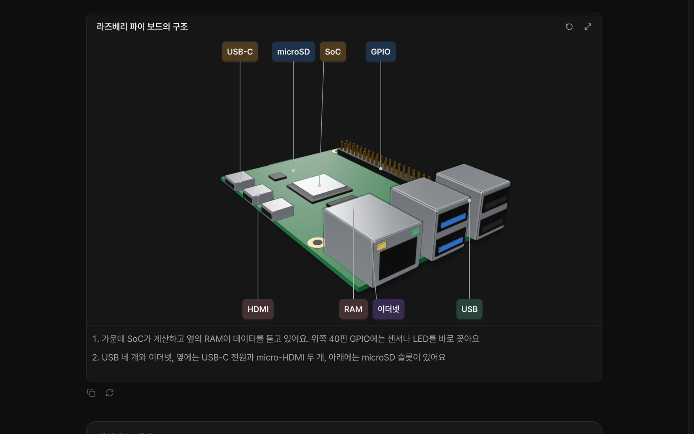</p>

<details>
<summary>보드와 차트</summary>

<p align="center">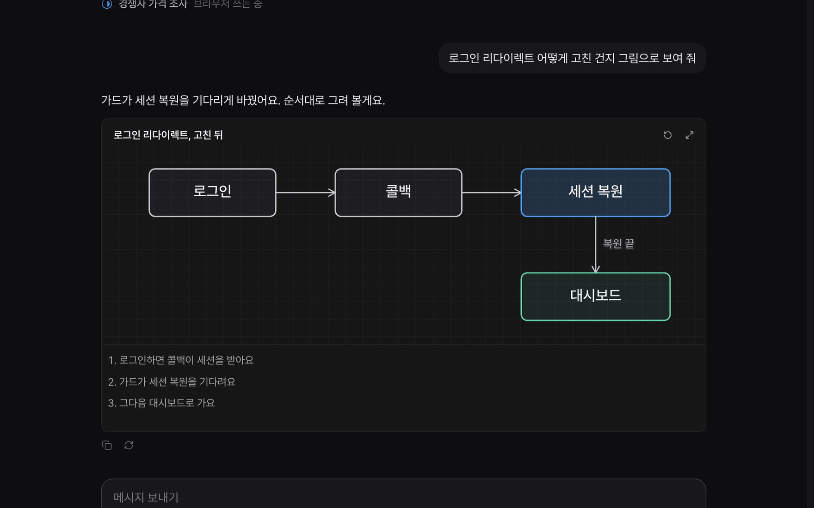</p>
<p align="center">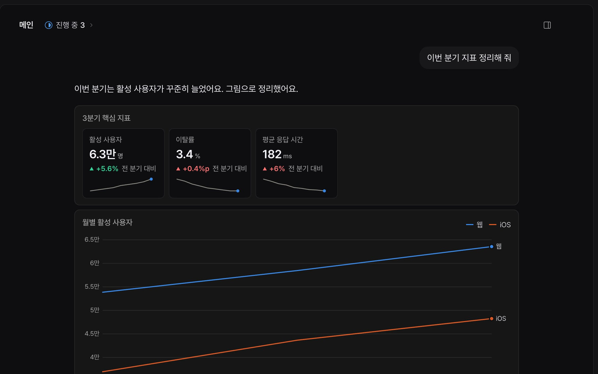</p>

</details>

## 그 밖에

- **메모리:** 한 번 정한 건 기억해요. 같은 질문에 같은 답을 하면 다음부터 묻지 않고, 프로젝트 규칙을 두 번 말하면 작업이 린트·테스트 같은 자동 검사로 만들어요. 취향과 배운 점을 남기거나 기존 메모를 가져올 수 있고, 자동 저장은 끌 수 있어요.
- **루틴:** 매일 하는 일은 루틴으로 만들어요. Ondra가 켜져 있고 Mac이 깨어 있는 동안 정한 시간에 돌아요.
- **다른 Mac:** 내 다른 Mac의 프로젝트로 작업을 돌릴 수 있어요. 화면은 이 앱에 그대로 보이고, 오가는 내용은 끝까지 암호화돼요.
- **`/btw`:** 일하는 중에도 하던 대화를 멈추지 않고 옆에서 짧게 물어볼 수 있어요.

<p align="center">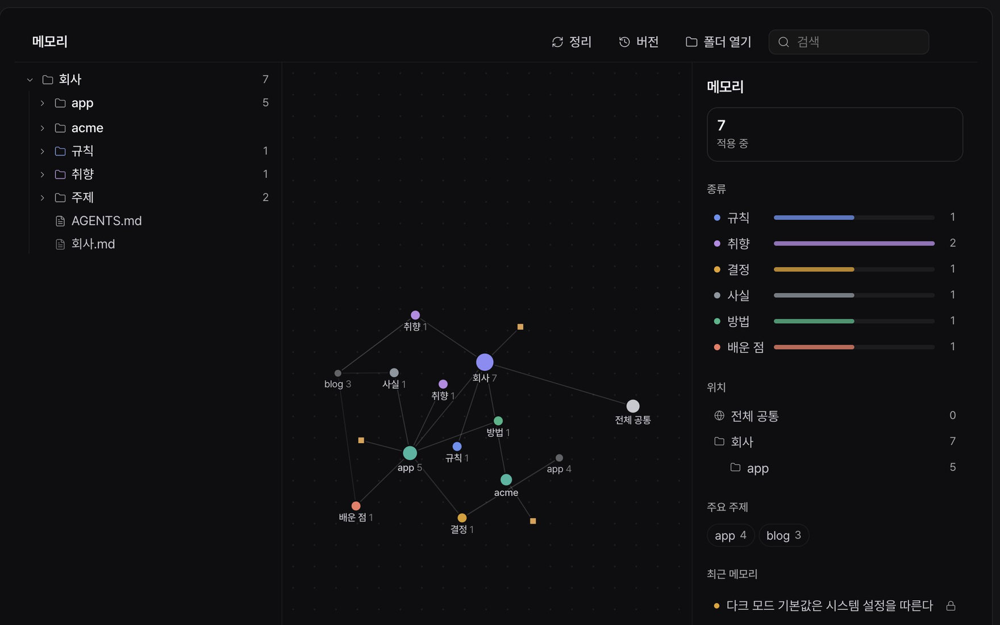</p>

<details>
<summary>채팅에서 만든 루틴</summary>

<p align="center">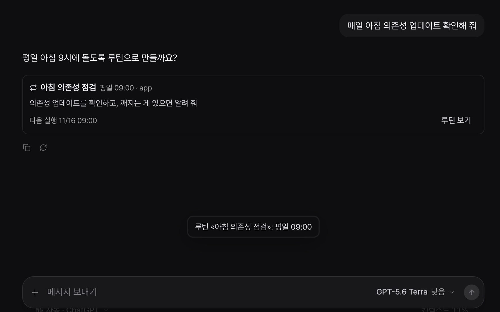</p>

</details>

<details>
<summary>워크스페이스, 설정과 그 밖의 기능</summary>

- **워크스페이스:** 일하는 방식에 맞춰 워크스페이스를 만들고 이름을 정하세요. 공간마다 계정과 지침을 따로 두고, 브라우저 로그인·메모리·작업 기록도 나눠 관리해요.
- **설정:** 모델, 권한, 동시 작업 수를 정할 수 있어요. 작업별 워크트리, 메모리 자동 저장, PR 리뷰 자동 대응도 켜거나 끌 수 있어요.
- **검색과 단축키:** 작업, 프로젝트, 메모리와 명령을 찾아요. 단축키는 설정에서 바꿀 수 있어요.
- **훅:** 작업 흐름 중 필요한 시점에 실행할 셸 명령을 설정할 수 있어요.
- **알림:** 시스템 알림을 허용하면 작업이 끝나거나 응답이 필요할 때 알림을 받을 수 있어요.
- **사용 통계:** 익명 사용 통계는 설정에서 끌 수 있어요. [보내는 항목](docs/TELEMETRY.md)을 확인하세요.

</details>

<details>
<summary>도구 사용 범위</summary>

- Mac 앱 조작에는 손쉬운 사용 권한이, 창 캡처에는 화면 기록 권한이 필요해요. 창 보호는 설정에서 바꿀 수 있으며, 운영체제 수준의 격리 기능은 아니에요.
- 모바일 작업은 기본적으로 자기 기기를 만들어요. 허용된 기존 기기를 지정해 사용할 수도 있고, 보호된 기기는 건드리지 않아요.
- 브라우저, 컴퓨터 사용, 디바이스 사용, 앱 확인, 딥리서치, 코드 리뷰, 시각 보고서, 웹 디자인 등의 스킬을 제공해요. `/skill:<이름>`으로 직접 부를 수도 있어요.

</details>

<br>

## 설치

**macOS 13 이상 · Apple silicon**

1. [최신 릴리스](https://github.com/3x-haust/ondra/releases)에서 `Ondra_<버전>_aarch64.dmg`를 받아 Ondra를 Applications로 옮겨요.
2. Ondra를 열고 설정에서 사용할 모델 계정(ChatGPT/Codex, Claude 등)을 연결해요.
3. 프로젝트를 선택하고 원하는 일을 말해요.

Ondra는 GitHub Releases를 확인해 앱 안에서 업데이트를 안내해요. Mac 앱 조작과 캡처에는 **손쉬운 사용·화면 기록** 권한이 필요해요. 모바일 기기에서 확인하려면 **Xcode의 iOS 시뮬레이터** 또는 **Android SDK의 에뮬레이터**를 준비해요.

<details>
<summary>macOS가 처음 실행을 막는 경우</summary>

[이 저장소의 릴리스](https://github.com/3x-haust/ondra/releases)에서 받은 앱인지 확인한 뒤 Finder에서 앱을 오른쪽 클릭해 **열기**를 선택해요. 격리 속성 때문에 계속 차단되는 경우에는 출처를 신뢰하는 앱에 한해 다음 명령을 한 번 실행할 수 있어요.

```sh
xattr -dr com.apple.quarantine /Applications/Ondra.app
```

</details>

<details>
<summary>소스에서 빌드하기</summary>

```sh
pnpm install
cp .env.example .env           # 필요한 값을 채워요
pnpm bundle                    # 도구, 에이전트 엔진과 앱 구성 요소를 준비해요
pnpm tauri dev                 # 개발 실행
pnpm release notes.md          # 릴리스 빌드 (scripts/release.mjs 참고)
```

- 에이전트 엔진은 [3xhaustpi](https://github.com/3x-haust/3xhaustpi)를 사용해요. 옆 폴더에 두거나 `ONDRA_ENGINE_DIST`로 `packages/coding-agent/dist`를 가리켜요.
- 엔진, Chrome, 바이너리 분석기는 버전별로 한 번 받는 컴포넌트예요. 업데이트에는 앱과 변경된 컴포넌트를 사용하고, DMG의 앱에는 이 구성 요소가 포함돼요.
- 정적 바이너리 분석에는 radare2와 r2ghidra, 네이티브 라이브러리와 프로세서 데이터가 포함돼요. 별도 분석 엔진 설치는 필요 없어요. [빌드와 패키지 검사](tools/binary-analysis/README.md)를 참고해요.
- 브라우저 도구(`ondra-browser`)와 컴퓨터 유즈 도우미(`ondra-cuhost`)는 우리가 Swift로 직접 만든 거예요. 외부 코드 없이 `src-tauri/helpers/browser/`와 `src-tauri/helpers/cuhost.swift`에 있고, `src-tauri/helpers/build.sh`가 빌드해요(Xcode 명령줄 도구).

</details>

<details>
<summary>로컬 설정과 저장소 구조</summary>

### 로컬 설정 (`.env`)

| 키 | 뜻 |
|---|---|
| `ONDRA_PROTECTED_DEVICES` | 어떤 작업도 켜거나 조작하면 안 되는 기기(정규식) |
| `ONDRA_DEVICES_ALLOWED` | 작업이 직접 만든 것 외에 사용해도 되는 기기 |

개발 빌드는 저장소의 `.env`를, 설치한 앱은 `~/Library/Application Support/dev.3xhaust.ondra/.env`를 읽어요.

### 구조

```text
src/                 SolidJS UI
  engine/            메인 대화와 작업, 프롬프트, 엔진 연결
  views/ ui/         화면과 부품
  styles/            디자인 토큰
src-tauri/src/       Rust: 엔진 프로세스, 브라우저, 워크트리, 키체인, 기기
skills/              작업에 필요한 스킬
extensions/          권한, 컴퓨터·기기 조작, 훅, 메모리 등 엔진 확장
brand/ docs/         브랜드와 문서
```

</details>

---

<p align="center">
  <a href="https://github.com/3x-haust/ondra/releases">릴리스</a> · <a href="docs/TELEMETRY.md">사용 통계</a> · <a href="https://github.com/3x-haust/ondra/issues">문제 알리기</a> · <a href="LICENSE">MIT 라이선스</a>
</p>
<p align="center"><sub>README와 영상 속 화면은 예시 데이터를 써요. 함께 쓰는 오픈소스의 라이선스는 앱 안의 설정 › 정보 › 오픈소스 라이선스에서 볼 수 있어요.</sub></p>
