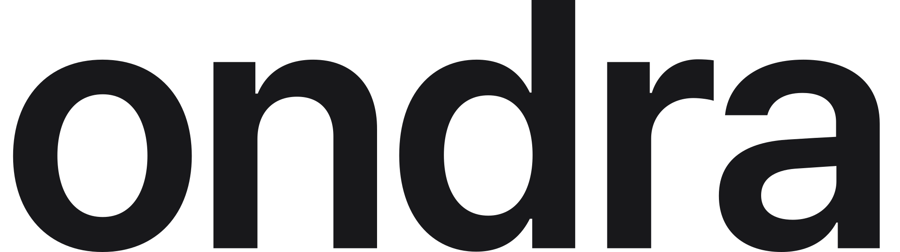
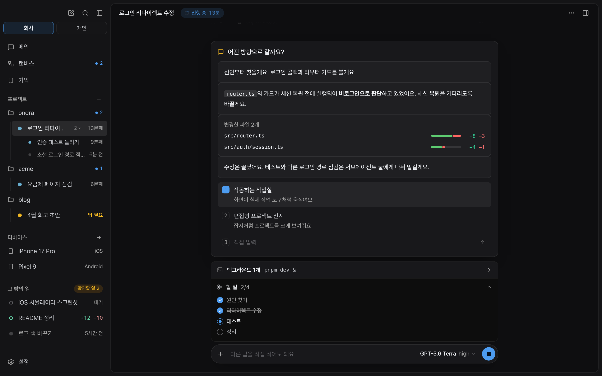

<p align="center">
  
</p>

<p align="center">
  <picture>
    <source media="(prefers-color-scheme: dark)" srcset="docs/assets/wordmark-dark.svg">
    
  </picture>
</p>

<p align="center"><b>AI의 말을, 보이게.</b></p>

<p align="center"><a href="README.md">English</a> · <b>한국어</b></p>

<p align="center">
  <a href="https://github.com/3x-haust/ondra/releases"></a>
  
  
</p>

<p align="center">
  
</p>

Ondra는 macOS용 에이전트 작업 공간이에요. 메인에게 원하는 걸 한 번 말하면, 메인이 일을 나눠 맡기고 일마다 자기 브랜치에서 끝까지 해요. 결과는 메인으로 돌아와요. 무엇을 바꿨는지, 왜 그랬는지, 어떻게 확인했는지까지요. 길고 어려운 모델의 말은 진행 상황, 바뀐 파일, 화면, 선택지로 바뀌어서 보여요.

<table>
  <tr>
    <td width="50%" valign="top">
      <b>대화 하나, 일 여러 개</b><br>
      메인이 계획하고 나눠 맡기고 결과를 알려 줘요. 일 하나하나를 지켜보지 않아도 돼요.
    </td>
    <td width="50%" valign="top">
      <b>회사와 개인은 따로</b><br>
      공간마다 git 계정, 브라우저 로그인, 기억, 기기, 기록이 따로예요.
    </td>
  </tr>
  <tr>
    <td valign="top">
      <b>읽지 않고 봐요</b><br>
      긴 글 대신 계획, 할 일, 바뀐 코드, 전후 사진, 테스트 결과, 그림으로 보여요.
    </td>
    <td valign="top">
      <b>말이 아니라 증거</b><br>
      "끝났어요"마다 실제로 돌린 것과 맞춰 봐요. 확인 못 한 건 그렇다고 적어요.
    </td>
  </tr>
</table>

## 어떻게 일하나요

**메인이 일을 나눠요.** "포트폴리오 사이트 만들어 줘"를 자료 확인, 레퍼런스 찾기, 계획, 만들기, 확인으로 나누고, 앞 단계가 끝나면 다음 단계가 시작돼요. 프로젝트 폴더마다 채팅이 따로 있고, 거기서 맡긴 일은 그 폴더에서 해요.

**일은 매번 새로 시작해요.** 일은 원격의 최신 코드에서 만든 자기 워크트리에서 해요. 그래서 일끼리, 또 내가 쓰는 폴더와 서로 덮어쓰지 않아요. 끝난 일에 더 시키면 그 브랜치와 결과를 이어받는 새 일이 시작돼요. 하던 중에 방향을 바꾸면 하던 일은 정리하고 새 일이 이어서 해요.

**결과는 메인으로 와요.** 일이 끝나면 메인이 일에 맞게 정리해서 알려 줘요. 버그면 원인, 고친 것, 확인한 것. 기능이면 바뀐 것. 릴리스면 나간 것. 조사면 답과 근거요.

**판단할 것만 물어요.** 의도나 취향이 필요한 것만 선택지와 맥락을 붙여 올라와요. 하나를 고르고 엔터를 누르거나 직접 적으면 돼요. 돌고 있는 일에 끼어들어 방향을 바꿀 수도 있어요.

<p align="center">
  
</p>

## 공간

회사와 개인은 필터가 아니라 완전히 다른 작업 공간이에요. 공간을 바꾸면 전부 바뀌어요.

- **계정:** 커밋, 푸시, PR, 터미널은 그 공간의 git 계정과 GitHub 로그인으로 해요. 계정이 없으면 다른 공간 것을 빌리지 않고 알려 줘요.
- **브라우저:** 로그인과 쿠키가 공간을 넘어가지 않아요.
- **기억과 스킬:** 한 공간에서 배운 건 그 공간에서만 써요.
- **기기:** 시뮬레이터와 에뮬레이터마다 회사, 개인, 공용을 정해요.
- **기록:** 검색, 사이드챗, `btw`, 입력 기록은 그 공간 것만 보여요. 일은 다른 일이나 다른 공간의 파일과 기록을 읽지 못해요.

## 일이 보고 쓰는 것

**공유 브라우저.** 앱 안의 진짜 Chrome이고, 일마다 탭이 하나씩 생겨요. 패널에서 한 번 로그인하면 그 공간의 일들이 같이 써요. 비밀번호는 macOS 키체인에서 넣고 모델에게는 가지 않아요. Aside가 있으면 Aside로 브라우징해요.

**컴퓨터 유즈.** Mac 앱 조작에는 별도로 준비한 격리 macOS 환경이 필요해요. 지금 Mac에 열려 있는 창을 조작하는 기능은 아니에요. 특정 앱으로 보내는 입력을 포함해 알려진 호스트 조작 명령을 차단하고, 확인된 게스트 연결이 없으면 중단해요. 이 명령 검사가 임의의 셸 프로그램까지 운영체제 수준으로 격리하는 것은 아니에요.

**디바이스 유즈.** 일마다 자기 iOS 시뮬레이터나 Android 에뮬레이터를 만들어 쓰고, 증거 사진을 남기고, 끝나면 지워요. 디바이스 패널에서 화면을 보고 직접 만질 수도 있어요. 에뮬레이터는 Mac GPU로 그리고, 화면이 그대로면 쉬어요.

**딥리서치.** 여러 조사원이 동시에 찾고 보고서 하나로 묶어요. 맨 위에 답과 지금 할 일, 어떻게 돌아가는지는 단계 그림으로, 선택지는 나란히 비교해요. PDF도 같이 만들어요.

## 읽지 않고 봐요

일은 앱이 그려 주는 블록으로 보고해요.

- 계획과 할 일. 실제 진행과 맞게 따라가요.
- 바뀐 파일과 줄 수, 패널에서 보는 diff
- 전후 사진, 영상, HTML 페이지. 패널에서 바로 열려요.
- 테스트 결과, 표, 체크리스트, 구조와 흐름 그림
- 주장마다 증거와, 앱이 확인했는지 여부

캔버스에서는 메인, 프로젝트, 일, 서브에이전트가 어떻게 이어지는지, 각자 지금 무엇을 하는지 한눈에 보여요.

<p align="center">
  
</p>

## 증거와 리뷰

- **증거를 맞춰 봐요.** 일이 "끝났어요"라고 하면 앱이 세션 기록과 비교해요. 그 명령을 실제로 돌렸는지, 통과했는지, 그 뒤에 코드가 바뀌었는지, 파일이 있는지요. 안 맞으면 돌려보내고, 끝까지 확인 못 한 건 따로 적어요.
- **내보내기 전에 리뷰해요.** 크거나 위험한 변경은 푸시, 머지, 릴리스 전에 리뷰 서브에이전트가 보고, 일이 지적받은 걸 고쳐요.
- **두 번 확인하지 않아요.** 통과한 검사는 그 범위를 건드리는 변경이 있기 전까지 유효해요. 릴리스할 때 앞에서 확인한 수정을 다시 시험하지 않아요.

## PR

- **PR 탭.** 일의 PR이 옆 패널에서 열려요. 상태, 검사, 리뷰와 코멘트 스레드, 바뀐 파일이 보이고, 줄 코멘트는 그 줄 아래에 붙어요. 코멘트를 버튼 하나로 일에게 넘길 수 있어요.
- **PR에 사진.** 일이 스크린샷과 영상을 PR 설명, 코멘트, 리뷰 답글, 코드 한 줄에 다는 코멘트로 넣어요. GitHub 편집기와 같은 방식으로 올려요.
- **PR 지켜보기 (선택).** 설정에서 켜면 일이 연 PR을 지켜봐요. 새 리뷰, 실패한 검사, 충돌이 생기면 일에게 넘기고, 일이 고친 뒤 그 스레드에 답해요.

## 그 밖에

- **기억:** 규칙, 취향, 배운 것을 필요할 때만 꺼내 써요. 그래프로 어떻게 이어지는지 보여요. 다른 도구의 메모(CLAUDE.md, AGENTS.md…)도 가져올 수 있어요.
- **btw와 사이드챗:** 하던 대화를 멈추지 않고 짧게 물어보거나(`/btw`), 공간마다 두 번째 대화를 따로 둬요(⌘J).
- **검색(⌘K):** 일, 프로젝트, 기억, 명령을 찾아요.
- **훅:** 도구를 쓰기 전후, 요청을 받을 때, 일을 시작하고 마칠 때 내 셸 명령을 돌려요. 공간마다 걸 수 있어요.
- **알림:** 창이 뒤에 있을 때 끝남, 답 필요, 멈춤을 공간 이름과 함께 알려 줘요.
- **스킬:** 브라우저, 컴퓨터 유즈, 디바이스, 딥리서치, 코드 리뷰, 시각 보고서, 웹 디자인 등. `/skill:<이름>`으로 불러요.
- **사용 통계:** 익명 숫자만 보내요(횟수, 버전, 모델 이름). 무엇을 시켰는지, 파일, 계정은 보내지 않아요. 설정에서 끌 수 있어요. [보내는 것](docs/TELEMETRY.md).

## 설치

1. [Releases](https://github.com/3x-haust/ondra/releases)에서 `Ondra_<버전>_aarch64.dmg`를 받아 Ondra를 Applications로 옮겨요.
2. 베타는 아직 공증 전이에요. 처음 열 때는 Finder에서 앱을 오른쪽 클릭해 **열기**를 고르거나, 한 번 실행해요:

   ```sh
   xattr -dr com.apple.quarantine /Applications/Ondra.app
   ```
3. 설정에서 모델 계정(ChatGPT/Codex, Claude …)을 연결하면 돼요. Mac 앱 조작에는 앱과 권한을 따로 준비한 macOS 게스트가 필요해요. 현재 Mac의 손쉬운 사용·화면 기록 권한만 허용해서는 격리 환경이 만들어지지 않아요.

Ondra는 GitHub Releases를 확인해서 앱 안에서 업데이트해요.

macOS 13 이상, Apple silicon만 지원해요. 디바이스 유즈는 Xcode(iOS 시뮬레이터)나 Android SDK(에뮬레이터)가 필요해요.

## 소스에서 빌드

```sh
pnpm install
cp .env.example .env           # 필요하면 값을 채워요
pnpm bundle                    # agent-browser, agent-desktop, 엔진, 헤드리스 Chrome, 바이너리 분석기를 준비해요
pnpm tauri dev                 # 개발 실행
pnpm release notes.md          # 릴리스 빌드: 업데이트 패키지, .dmg, latest.json (scripts/release.mjs 참고)
```

- 에이전트 엔진, Chrome, 바이너리 분석기는 컴포넌트예요. 앱이 버전마다 한 번 데이터 폴더로 받아서, 업데이트에는 앱만 들어 있어요. .dmg의 앱은 이걸 안에 갖고 있어서 오프라인에서도 돼요.

- 에이전트 엔진은 [3xhaustpi](https://github.com/3x-haust/3xhaustpi)의 coding-agent를 파일 하나로 빌드한 거예요. 옆 폴더에 두거나 `ONDRA_ENGINE_DIST`로 가리켜요.
- macOS 27에서는 pid가 -1인 앱(Xcode의 Device Hub)이 떠 있으면 agent-desktop 1.1.0의 모든 명령이 멈춰요. `scripts/patches/`의 패치로 빌드해서 `~/.cache/ondra/agent-desktop-patched`에 두면 bundle 단계가 그걸 써요.

### 로컬 설정 (`.env`)

| 키 | 뜻 |
|---|---|
| `ONDRA_PROTECTED_DEVICES` | 어떤 일도 켜거나 건드리면 안 되는 기기(정규식). 예: 팀이 같이 쓰는 시뮬레이터 |
| `ONDRA_DEVICES_ALLOWED` | 일이 직접 만든 것 말고 써도 되는 기기 |

개발 빌드는 레포의 `.env`를, 설치한 앱은 `~/Library/Application Support/dev.3xhaust.ondra/.env`를 읽어요.

## 구조

```
src/                 SolidJS UI
  engine/            메인 대화(captain)와 일(tasks), 프롬프트, 엔진 RPC
  views/ ui/         화면과 부품 · styles/ 디자인 토큰
src-tauri/src/       Rust: 엔진 프로세스, 공유 브라우저, 워크트리, 키체인, 기기, 알림
skills/              모든 일이 받는 스킬
extensions/          엔진 확장(권한, 기기, 훅, 기억)
brand/ docs/         브랜드와 디자인 시스템
```
