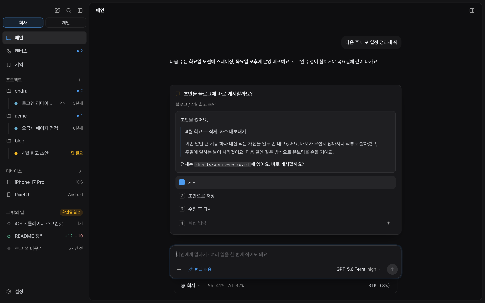
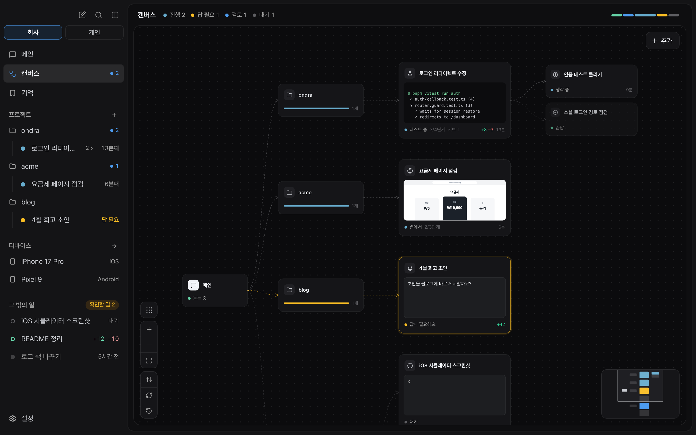

<p align="center">
  
</p>

<h1 align="center">AI를 관리하지 말고,<br>일을 맡기세요.</h1>

<p align="center">
  Ondra는 맡긴 일을 나누고, 필요한 도구로 실행하고, 확인한 결과를 가져오는 AI 작업 공간입니다.<br>
  중요한 결정은 당신에게 남깁니다.
</p>

<p align="center">
  <a href="https://github.com/3x-haust/ondra/releases"><b>macOS용 다운로드 ↗</b></a> · <a href="#설치">설치 안내</a> · <a href="README.md">English</a>
</p>

<p align="center"><sub>macOS 13 이상 · Apple silicon</sub></p>

<p align="center">
  
</p>

## 원하는 일을 말하세요. 나머지는 함께 풀어가요.

**일을 나누고.** 메인이 요청을 작업으로 나누고, 각 작업은 맡은 범위를 끝까지 진행해요. 프로젝트마다 대화를 따로 두고, 그곳에서 맡긴 작업은 해당 폴더에서 해요.

**필요한 곳에서 실행하고.** 코드와 문서뿐 아니라 브라우저, Mac 앱, 모바일 기기까지. 작업에 맞는 도구와 스킬로 실행해요.

**확인한 결과를 가져와요.** 무엇을 바꿨는지, 어떻게 확인했는지, 무엇이 남았는지 메인이 모아 알려줘요. 버그라면 원인과 수정, 조사라면 답과 근거, 배포라면 나간 것과 현재 상태를 받아요.

<details>
<summary>작업 흐름을 한눈에 보기</summary>

캔버스에서 메인, 프로젝트, 작업과 서브에이전트의 연결을 볼 수 있어요. 각 작업이 지금 무엇을 하는지도 함께 보여요.



</details>

<details>
<summary>세션과 컨텍스트를 직접 관리하지 않아도 돼요</summary>

- **작업별 세션:** 작업마다 대화를 나눠요. 작업별 워크트리를 켜면 Git 변경 사항을 다른 작업이나 내가 쓰는 폴더와 분리할 수 있어요.
- **이어가기:** 긴 작업은 완료한 일, 발견한 내용, 다음 단계와 증거를 새 세션에 넘겨요. 끝난 작업에 더 요청하거나 진행 중 방향을 바꾸면, 앞선 결과를 이어받는 새 작업이 시작돼요.
- **캐시 재사용:** 공통 지침과 계정 선택은 프롬프트 캐시를 재사용할 수 있도록 구성해요. 실제 캐시 사용은 모델과 제공자에 따라 달라요.

</details>

<br>

## 중요한 결정은 당신에게.

의도나 취향이 필요한 순간에는 선택지와 맥락을 함께 보여줘요. 하나를 고르고 Enter를 누르거나 직접 답을 적으면 돼요. 진행 중인 작업에 들어가 방향을 바꿀 수도 있어요.

> 맡길 수 있는 실행은 Ondra에게. 방향을 정하는 판단은 당신에게.

### 결과에는 확인한 내용도 함께

- **말보다 결과:** 계획, 바뀐 파일과 diff, 전후 화면, 영상, 테스트 결과로 보여줘요. HTML 결과물, 표, 체크리스트와 그림도 패널에서 열어볼 수 있어요.
- **기록과 대조:** 완료 보고에 붙은 명령 실행과 파일 등의 증거를 작업 기록과 맞춰 봐요. 확인되지 않은 항목은 따로 표시해요.
- **필요한 검토:** 복잡하거나 민감한 변경은 계획과 코드 리뷰로 살펴볼 수 있어요. 검토 과정은 작업 범위와 프로젝트 지침을 따라요.
- **확인은 이어서:** 통과한 검사는 그 범위의 코드가 바뀌기 전까지 이어서 써요. 배포했다는 이유만으로 같은 검사를 반복하지 않아요.

<br>

## 맡긴 일에 필요한 도구들

**브라우저.** 작업마다 자기 탭에서 웹을 살펴보고 조작해요. 같은 워크스페이스에서는 로그인 상태를 함께 쓰고, 비밀번호는 macOS 키체인으로 입력해 모델에 노출하지 않아요.

**Mac 앱.** 필요한 권한을 허용하면 Mac 앱을 조작하고, 그 앱의 창을 캡처해 결과를 확인할 수 있어요. 앞에서 쓰는 앱을 유지하도록 돕는 창 보호 설정도 제공해요.

**모바일.** 플랫폼 도구를 설치하면 iOS 시뮬레이터와 Android 에뮬레이터에서 앱을 확인하고 화면을 남길 수 있어요. Ondra 안에서 기기 화면을 보고 직접 조작할 수도 있어요.

**딥리서치.** 질문을 나눠 출처를 조사하고, 인용을 원문과 대조해요. 답과 근거, 선택지 비교를 시각 보고서와 PDF로 모아요.

<details>
<summary>도구 사용 범위</summary>

- Mac 앱 조작에는 손쉬운 사용 권한이, 창 캡처에는 화면 기록 권한이 필요해요. 창 보호는 설정에서 바꿀 수 있으며, 운영체제 수준의 격리 기능은 아니에요.
- 모바일 작업은 기본적으로 자기 기기를 만들어요. 허용된 기존 기기를 지정해 사용할 수도 있고, 보호된 기기는 건드리지 않아요.
- 브라우저, 컴퓨터 사용, 디바이스 사용, 딥리서치, 코드 리뷰, 시각 보고서, 웹 디자인 등의 스킬을 제공해요. `/skill:<이름>`으로 직접 부를 수도 있어요.

</details>

<br>

## 내 일에 맞는 작업 공간

일하는 방식에 맞춰 워크스페이스를 만들고 이름을 정하세요. 공간마다 계정과 지침을 설정하고, 브라우저 로그인·메모리·작업 기록을 나눠 관리할 수 있어요.

설정에서 모델, 권한, 동시 작업 수를 정할 수 있어요. 작업별 워크트리, 메모리 자동 저장, PR 리뷰 자동 대응도 필요에 맞게 켜거나 끌 수 있어요.

<details>
<summary>PR도 작업과 함께</summary>

GitHub 계정을 연결하면 PR 상태, 검사, 리뷰와 바뀐 파일을 작업 옆에서 볼 수 있어요. 리뷰 코멘트를 작업에 넘기거나, 스크린샷과 영상을 PR에 첨부할 수도 있어요.

푸시와 PR 변경에는 GitHub 쓰기 권한이 필요해요. 새 리뷰, 실패한 검사와 충돌에 작업이 대응하게 하려면 설정에서 리뷰 자동 대응을 켜세요.

</details>

<details>
<summary>필요한 기능을 내 방식으로</summary>

- **메모리:** 유용한 취향과 배운 내용을 남기거나 기존 메모를 가져올 수 있어요. 자동 저장은 끌 수 있어요.
- **짧은 질문:** `/btw`로 하던 대화를 멈추지 않고 곁가지 질문을 하거나, 사이드챗을 열 수 있어요.
- **검색과 단축키:** 작업, 프로젝트, 메모리와 명령을 찾아요. 단축키는 설정에서 바꿀 수 있어요.
- **훅:** 작업 흐름 중 필요한 시점에 실행할 셸 명령을 설정할 수 있어요.
- **알림:** 시스템 알림을 허용하면 작업이 끝나거나 응답이 필요할 때 알림을 받을 수 있어요.
- **사용 통계:** 익명 사용 통계는 설정에서 끌 수 있어요. [보내는 항목](docs/TELEMETRY.md)을 확인하세요.

</details>

<br>

## 설치

**macOS 13 이상 · Apple silicon**

1. [최신 릴리스](https://github.com/3x-haust/ondra/releases)에서 `Ondra_<버전>_aarch64.dmg`를 받아 Ondra를 Applications로 옮겨요.
2. Ondra를 열고 설정에서 사용할 모델 계정(ChatGPT/Codex, Claude 등)을 연결해요.
3. 프로젝트를 선택하고 원하는 일을 말해요.

Ondra는 GitHub Releases를 확인해 앱 안에서 업데이트를 안내해요. Mac 앱 조작과 캡처에는 **손쉬운 사용·화면 기록** 권한이 필요해요. 모바일 기기에서 확인하려면 **Xcode의 iOS 시뮬레이터** 또는 **Android SDK의 에뮬레이터**를 준비해요.

<details>
<summary>macOS가 처음 실행을 막는 경우</summary>

[이 저장소의 릴리스](https://github.com/3x-haust/ondra/releases)에서 받은 앱인지 확인한 뒤 Finder에서 앱을 오른쪽 클릭해 **열기**를 선택해요. 격리 속성 때문에 계속 차단되는 경우에는 출처를 신뢰하는 앱에 한해 다음 명령을 한 번 실행할 수 있어요.

```sh
xattr -dr com.apple.quarantine /Applications/Ondra.app
```

</details>

<details>
<summary>소스에서 빌드하기</summary>

```sh
pnpm install
cp .env.example .env           # 필요한 값을 채워요
pnpm bundle                    # 도구, 에이전트 엔진과 앱 구성 요소를 준비해요
pnpm tauri dev                 # 개발 실행
pnpm release notes.md          # 릴리스 빌드 (scripts/release.mjs 참고)
```

- 에이전트 엔진은 [3xhaustpi](https://github.com/3x-haust/3xhaustpi)를 사용해요. 옆 폴더에 두거나 `ONDRA_ENGINE_DIST`로 `packages/coding-agent/dist`를 가리켜요.
- 엔진, Chrome, 바이너리 분석기는 버전별로 한 번 받는 컴포넌트예요. 업데이트에는 앱과 변경된 컴포넌트를 사용하고, DMG의 앱에는 이 구성 요소가 포함돼요.
- 정적 바이너리 분석에는 radare2와 r2ghidra, 네이티브 라이브러리와 프로세서 데이터가 포함돼요. 별도 분석 엔진 설치는 필요 없어요. [빌드와 패키지 검사](tools/binary-analysis/README.md)를 참고해요.

- 브라우저 도구(`ondra-browser`)와 컴퓨터 유즈 도우미(`ondra-cuhost`)는 우리가 Swift로 직접 만든 거예요. 외부 코드 없이 `src-tauri/helpers/browser/`와 `src-tauri/helpers/cuhost.swift`에 있고, `src-tauri/helpers/build.sh`가 빌드해요(Xcode 명령줄 도구).

</details>

<details>
<summary>로컬 설정과 저장소 구조</summary>

### 로컬 설정 (`.env`)

| 키 | 뜻 |
|---|---|
| `ONDRA_PROTECTED_DEVICES` | 어떤 작업도 켜거나 조작하면 안 되는 기기(정규식) |
| `ONDRA_DEVICES_ALLOWED` | 작업이 직접 만든 것 외에 사용해도 되는 기기 |

개발 빌드는 저장소의 `.env`를, 설치한 앱은 `~/Library/Application Support/dev.3xhaust.ondra/.env`를 읽어요.

### 구조

```text
src/                 SolidJS UI
  engine/            메인 대화와 작업, 프롬프트, 엔진 연결
  views/ ui/         화면과 부품
  styles/            디자인 토큰
src-tauri/src/       Rust: 엔진 프로세스, 브라우저, 워크트리, 키체인, 기기
skills/              작업에 필요한 스킬
extensions/          권한, 컴퓨터·기기 조작, 훅, 메모리 등 엔진 확장
brand/ docs/         브랜드와 문서
```

</details>

---

<p align="center">
  <a href="https://github.com/3x-haust/ondra/releases">릴리스</a> · <a href="docs/TELEMETRY.md">사용 통계</a> · <a href="https://github.com/3x-haust/ondra/issues">문제 알리기</a> · <a href="LICENSE">MIT 라이선스</a>
</p>
<p align="center"><sub>함께 쓰는 오픈소스의 라이선스는 앱 안의 설정 › 정보 › 오픈소스 라이선스에서 볼 수 있어요.</sub></p>
