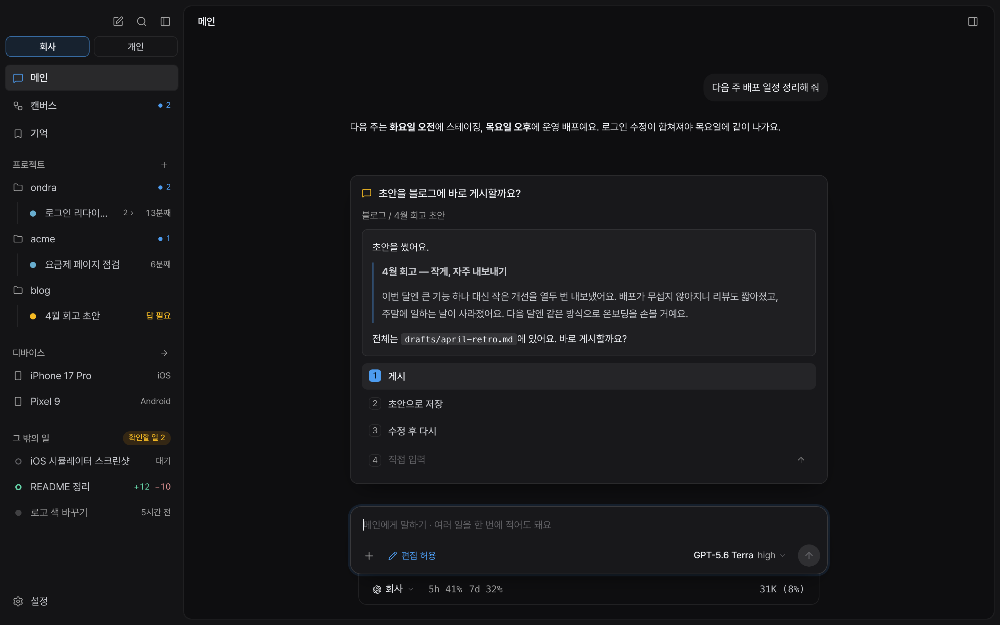
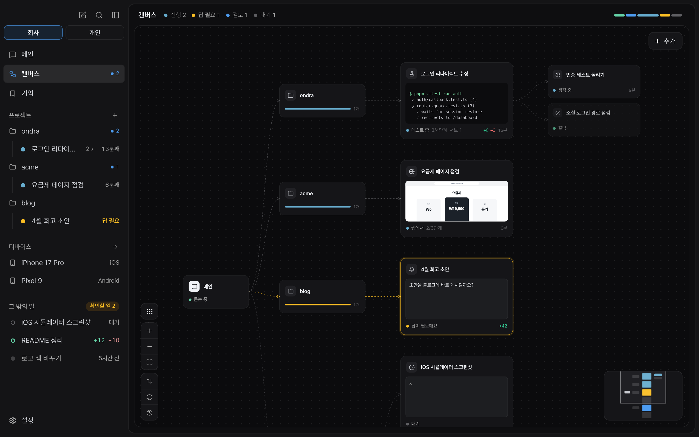

<p align="center">
  
</p>

<h1 align="center">Don't manage AI.<br>Delegate the work.</h1>

<p align="center">
  Ondra is an AI workspace that breaks down the work you delegate, uses the tools it needs, and brings back results it has checked.<br>
  The important decisions stay with you.
</p>

<p align="center">
  <a href="https://github.com/3x-haust/ondra/releases"><b>Download for macOS ↗</b></a> · <a href="#install">Install</a> · <a href="README.ko.md">한국어</a>
</p>

<p align="center"><sub>macOS 13+ · Apple silicon</sub></p>

<p align="center">
  
</p>

## Say what you want done. Work through the rest together.

**Break down the work.** Main turns your request into tasks, and each task follows its part through. Every project has its own conversation, and work started there runs in that folder.

**Use the right tools.** Code and documents, browsers, Mac apps and mobile devices. Each task uses the tools and skills the work calls for.

**Bring back checked results.** Main gathers what changed, how it was checked and what remains. A bug comes back with its cause and fix; research with an answer and sources; a release with what shipped and its current status.

<details>
<summary>See the work at a glance</summary>

The canvas shows how Main, projects, tasks and subagents connect, along with what each task is doing now.



</details>

<details>
<summary>Let Ondra look after sessions and context</summary>

- **A session per task:** each task has its own conversation. Git tasks use a dedicated branch and worktree by default, keeping their changes separate from other tasks and your working folder.
- **Carry the work forward:** long tasks hand completed work, findings, next steps and evidence to a fresh session. Following up on a finished task or changing direction starts a new task that takes over the earlier results.
- **Reuse the cache:** shared instructions and account selection are arranged to reuse prompt caches. Actual cache use depends on the model and provider.

</details>

<br>

## The important decisions stay with you.

When your intent or taste matters, Ondra brings you choices with context. Pick one and press Enter, or write your own answer. You can also step into a running task and change its direction.

> Delegate the execution. Keep the decisions that set the direction.

### Results come with what was checked

- **Show the work:** plans, changed files and diffs, before-and-after screens, videos and test results. Open HTML results, tables, checklists and diagrams in the panel too.
- **Check the record:** completion reports are compared with the task's recorded commands, files and other evidence. Unverified items are marked separately.
- **Review where it matters:** multi-part features and redesigns get a plan review. Changes involving security, authentication, payments or possible data loss are reviewed from design and code perspectives, then revised to address the findings.
- **Carry checks forward:** a passing check stays valid until the code it covers changes. Shipping alone is not a reason to repeat it.

<br>

## Tools for the work you delegate

**Browser.** Each task uses its own tab to read and interact with the web. Logins are shared within a workspace; passwords are entered through the macOS Keychain without reaching the model. The app's shared browser is the default, with Aside available when requested.

**Mac apps.** Tasks operate an app on your Mac in the background and capture its window to check the result. Actions are designed to preserve your cursor and foreground app. No separate virtual Mac is required.

**Mobile.** Tasks run on their own iOS simulator or Android emulator, capture screen evidence and clean up afterward. You can watch and interact with the screen in the device panel. Emulators use the Mac GPU and pause rendering when the screen is unchanged.

**Deep research.** Split a question into research threads, investigate sources and check quotations against the originals. Bring the answer, evidence and comparisons together in a visual report and PDF.

<details>
<summary>Tool access and boundaries</summary>

- Mac app actions need Accessibility permission; window capture needs Screen Recording. If an app brings itself forward, Ondra attempts to restore the foreground app and reports an error if it cannot preserve it. This is not an OS-level isolation environment.
- Mobile tasks create their own devices by default. They can also use an explicitly allowed existing device; protected devices are left alone.
- Bundled skills include browser use, computer use, device use, deep research, code review, visual reports and web design. You can invoke one directly with `/skill:<name>`.

</details>

<br>

## Work and personal, kept apart

Switching workspaces switches accounts, browser logins, memory and task history. Handle work and personal projects in one app without mixing them together.

<details>
<summary>What belongs to each workspace</summary>

- **Accounts:** commits, pushes, PRs and terminals use that workspace's Git identity and GitHub login. A missing account is reported instead of borrowing another workspace's.
- **Browser:** logins and cookies are stored per workspace.
- **Memory and skills:** what Ondra learns in one workspace is used there.
- **Devices:** simulators and emulators can belong to work, personal or both.
- **History:** search, side chat, `btw` and input history show the current workspace's records.

</details>

<details>
<summary>Keep pull requests with the work</summary>

- **PR tab:** see status, checks, reviews, comment threads and changed files in the side panel. Line comments appear at their lines, and a button hands a comment to the task.
- **Show the result:** attach screenshots and videos to PR descriptions, comments, review replies or line comments.
- **Review follow-up:** opt in through Settings to watch PRs opened by tasks. New reviews, failed checks and conflicts go back to the task to fix and answer.

</details>

<details>
<summary>Memory, quick questions, search and notifications</summary>

- **Memory:** recall rules, preferences and lessons when relevant. Explore their connections in a graph and import notes from other tools, including `CLAUDE.md` and `AGENTS.md`.
- **Quick questions and side chat:** use `/btw` without interrupting the current conversation, or open a second conversation per workspace (⌘J).
- **Search:** find tasks, projects, memories and commands (⌘K).
- **Hooks:** set shell commands per workspace to run before or after tools, on a request, or when a task starts or stops.
- **Notifications:** when the app is in the background, get notified of completion, a needed reply or a stalled task, with the workspace name.
- **Telemetry:** anonymous usage data such as counts, versions and model names. It does not include your requests, files or accounts, and can be disabled in Settings. See [what is sent](docs/TELEMETRY.md).

</details>

<br>

## Install

**macOS 13+ · Apple silicon**

1. Download `Ondra_<version>_aarch64.dmg` from the [latest release](https://github.com/3x-haust/ondra/releases) and drag Ondra into Applications.
2. Open Ondra and connect a model account, such as ChatGPT/Codex or Claude, in Settings.
3. Choose a project and say what you want done.

Ondra checks GitHub Releases and offers updates in the app. Mac app actions and capture need **Accessibility and Screen Recording** permissions. To work with mobile devices, install **Xcode's iOS Simulator** or the **Android SDK emulator**.

<details>
<summary>If macOS blocks the first launch</summary>

Confirm that the app came from [this repository's releases](https://github.com/3x-haust/ondra/releases), then right-click it in Finder and choose **Open**. If the quarantine attribute still blocks it, you can run the following once, only for a download you trust:

```sh
xattr -dr com.apple.quarantine /Applications/Ondra.app
```

</details>

<details>
<summary>Build from source</summary>

```sh
pnpm install
cp .env.example .env           # fill in the values you need
pnpm bundle                    # prepare tools, the agent engine and app components
pnpm tauri dev                 # run in development
pnpm release notes.md          # release build (see scripts/release.mjs)
```

- The agent engine comes from [3xhaustpi](https://github.com/3x-haust/3xhaustpi). Put it in a sibling folder or point `ONDRA_ENGINE_DIST` at `packages/coding-agent/dist`.
- The engine, Chrome and binary analyzer are components downloaded once per version. Updates use the app and any changed components; the DMG's app includes these components.
- Static binary analysis includes radare2, r2ghidra, native libraries and processor data, with no separate analysis engine to install. See [build and package checks](tools/binary-analysis/README.md).
- On macOS 27, the bundled agent-desktop 1.1.0 can hang while an app with pid -1, such as Xcode's Device Hub, is running. Build it with the patch in `scripts/patches/` and place it at `~/.cache/ondra/agent-desktop-patched`; the bundle step uses it.

</details>

<details>
<summary>Local settings and repository layout</summary>

### Local settings (`.env`)

| Key | Meaning |
|---|---|
| `ONDRA_PROTECTED_DEVICES` | Devices no task may boot or operate (regex) |
| `ONDRA_DEVICES_ALLOWED` | Devices a task may use besides the ones it created |

Development builds read the repository's `.env`; the installed app reads `~/Library/Application Support/dev.3xhaust.ondra/.env`.

### Layout

```text
src/                 SolidJS UI
  engine/            main conversation and tasks, prompts, engine connection
  views/ ui/         screens and components
  styles/            design tokens
src-tauri/src/       Rust: engine process, browser, worktrees, keychain, devices
skills/              skills for tasks
extensions/          permissions, computer/device use, hooks, memory and other engine extensions
brand/ docs/         brand and documentation
```

</details>

---

<p align="center">
  <a href="https://github.com/3x-haust/ondra/releases">Releases</a> · <a href="docs/TELEMETRY.md">Telemetry</a> · <a href="https://github.com/3x-haust/ondra/issues">Report an issue</a>
</p>
