<p align="center">
  
</p>

<h1 align="center">Stop babysitting your agents.</h1>

<p align="center">
  Put everything you want done in one chat. Ondra splits it into tasks and runs them side by side.<br>
  When something needs your call, it asks. Before it says done, it checks.
</p>

<p align="center">
  <a href="https://github.com/3x-haust/ondra/releases"><b>Download for macOS · Windows · Linux ↗</b></a> · <a href="#install">Install</a> · <a href="README.ko.md">한국어</a>
</p>

<p align="center"><sub>macOS 13+ · Apple silicon</sub></p>

<p align="center">
  <a href="https://3x-haust.github.io/ondra/en/#film">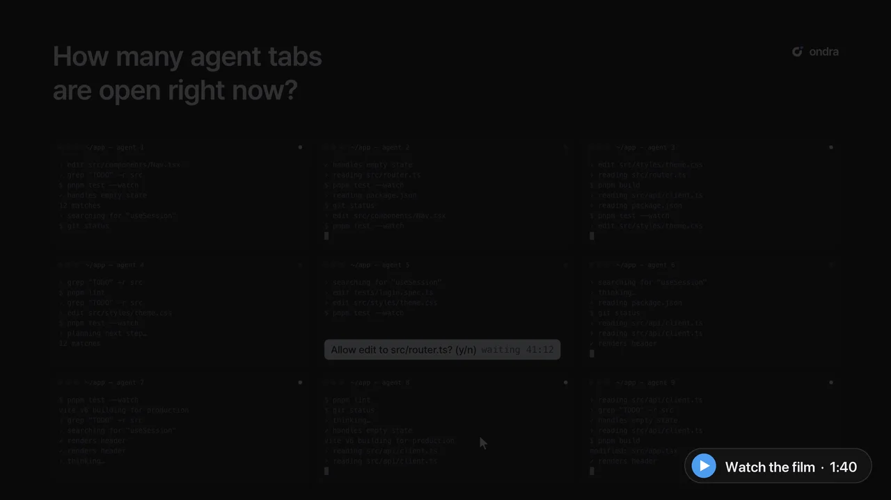</a>
</p>

<p align="center"><sub><a href="https://3x-haust.github.io/ondra/en/#film">Watch the full film (1:40) ↗</a> · Every Ondra screen in it is recorded from the app.</sub></p>

<br>

## One chat

Close the tabs. Say what you want done in Main, the one conversation for all your work. Each project also has its own conversation, and work started there runs in that folder.

<p align="center">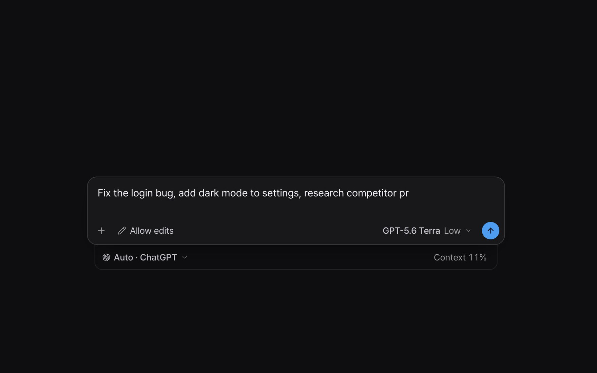</p>

## It splits the work into tasks

Main turns your request into tasks that run side by side, each following its part through. The canvas shows how Main, projects, tasks and subagents connect, and what each task is doing now.

<p align="center"></p>

<details>
<summary>The canvas in the app</summary>

<p align="center">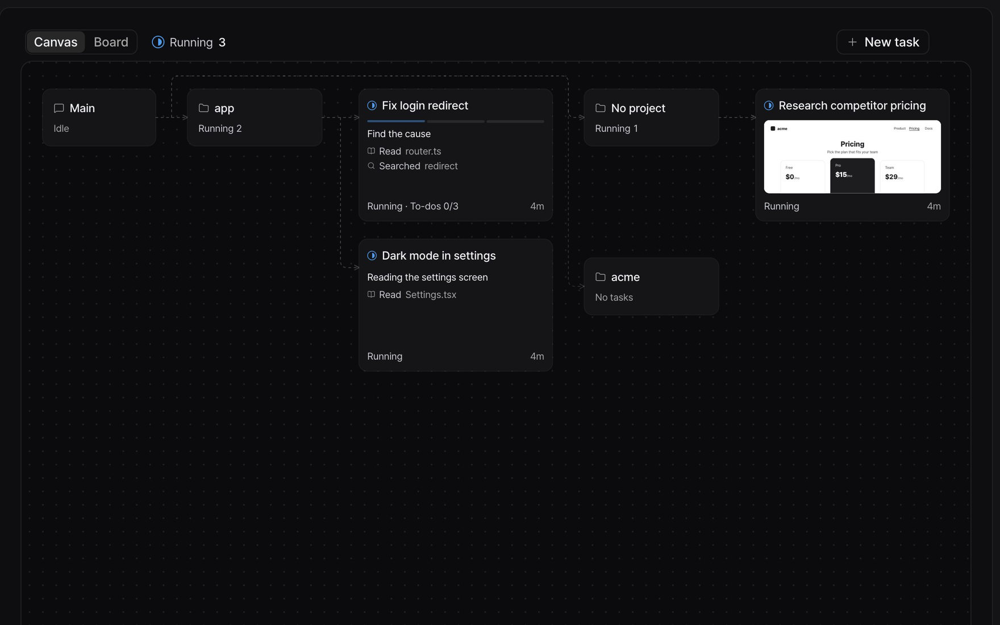</p>

</details>

<details>
<summary>Sessions and context are handled for you</summary>

- **A session per task:** each task has its own conversation. Enable per-task worktrees to keep Git changes separate from other tasks and your working folder.
- **Carry the work forward:** long tasks hand completed work, findings, next steps and evidence to a fresh session. Following up on a finished task or changing direction starts a new task that takes over the earlier results.
- **Reuse the cache:** shared instructions and account selection are arranged to reuse prompt caches. Actual cache use depends on the model and provider.

</details>

## It asks only when the call is yours

When your intent or taste matters, the question comes with context and choices. Press its number or Enter, or write your own answer. You can also step into a running task and change its direction.

<p align="center"></p>

<details>
<summary>Your turn in the app</summary>

<p align="center">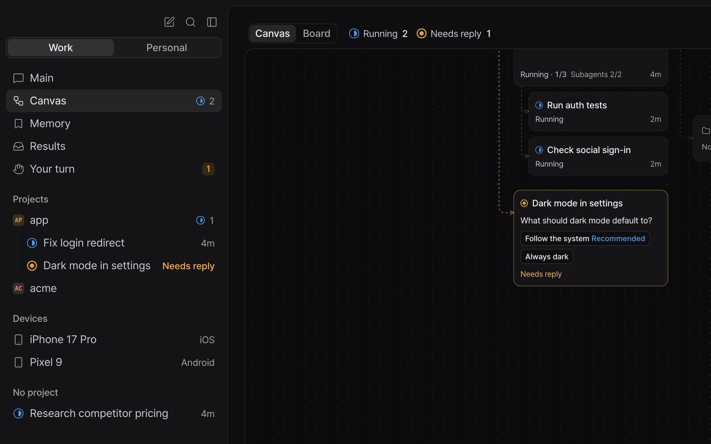</p>

</details>

## It checks in the real app before it says done

A task that changes an app starts its own copy and uses the change. What it saw is kept as screenshots and logs; what it couldn't check is marked as not checked. How to check the project is written down once as its own skill (`.agents/skills/check-<name>/`), and later tasks reuse it.

<p align="center"></p>

<details>
<summary>The check in the app</summary>

<p align="center">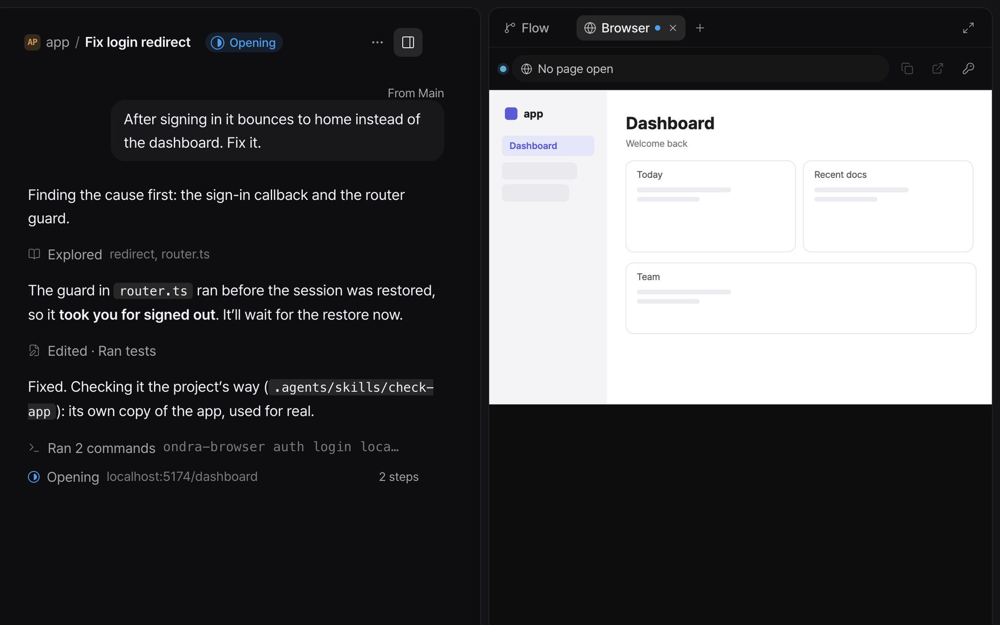</p>

</details>

<details>
<summary>What comes back with a result</summary>

- **Show the work:** plans, changed files and diffs, before-and-after screens, videos and test results. Open HTML results, tables, checklists and diagrams in the panel too.
- **Check the record:** completion reports are compared with the task's recorded commands, files and other evidence. Unverified items are marked separately.
- **Review where it matters:** plan and code reviews help check complex or sensitive changes. The review process follows the work's scope and project instructions.
- **Carry checks forward:** a passing check stays valid until the code it covers changes. Shipping alone is not a reason to repeat it.
- **Your call:** checking in the app is on by default; turn off *Check in the app before done* in Settings.

</details>

## Each task gets its own browser

Each task reads and works the web in its own tab. Logins are shared within a workspace; passwords are filled in from the macOS Keychain and never reach the model. Keep working elsewhere and watch a task's browser in the corner.

<p align="center">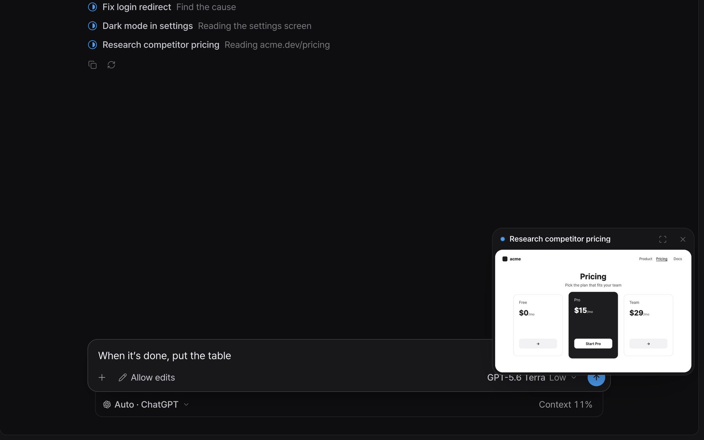</p>

## Computer use

With your permission, a task uses a Mac app in the background. It acts on that app directly, so your cursor and the app in front stay yours, and it captures the app's window to check the result.

<p align="center">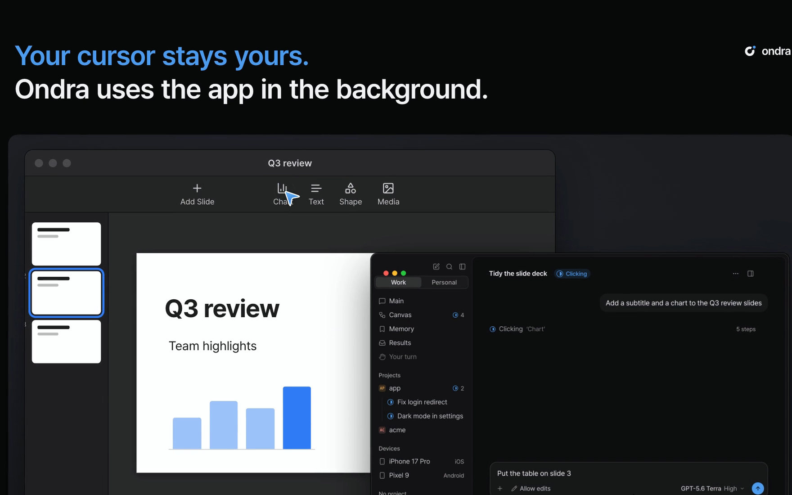</p>

## Simulators and emulators

With the platform tools installed, tasks use iOS simulators and Android emulators to check your mobile app and capture its screen. Watch and use the devices from Ondra.

<p align="center">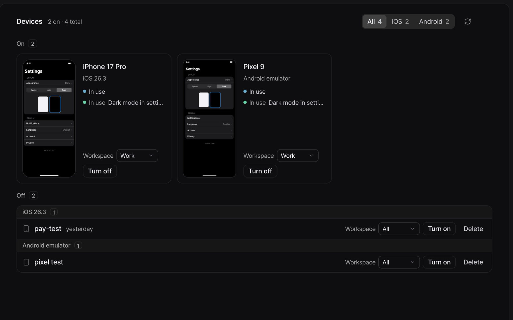</p>

## Research with sources

Deep research splits a question into threads, reads the sources and checks quotations against the originals. The answer comes back as a cited report and a PDF.

<p align="center">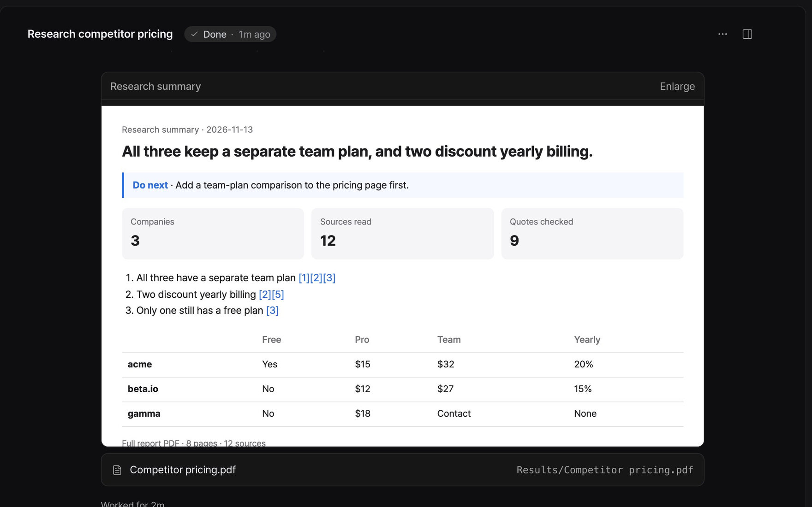</p>

## You decide what gets merged

When a task on its own worktree finishes with changes, it asks what happens to them: merge, open a PR, or discard. A bug or performance fix that changes nothing on screen goes in without asking once all of it is checked, and after you give the same answer three times in a row, that project stops asking. What your memory says always comes first. What tasks made collects in Results.

<p align="center">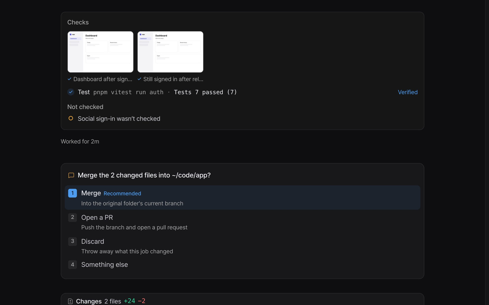</p>

<details>
<summary>Keep pull requests with the work</summary>

Connect a GitHub account to view PR status, checks, reviews and changed files alongside the task. Hand review comments back to the task, or attach screenshots and videos to a PR.

Pushes and PR changes require GitHub write access. Enable automatic review follow-up in Settings if you want tasks to respond to new reviews, failed checks and conflicts.

</details>

## When words aren't enough, it draws

Answers can draw a step-by-step board, build a 3D model you can turn, or lay out charts, diagrams and slides, right in the chat.

<p align="center">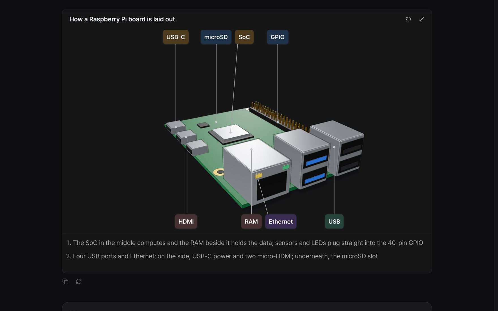</p>

<details>
<summary>Boards and charts</summary>

<p align="center">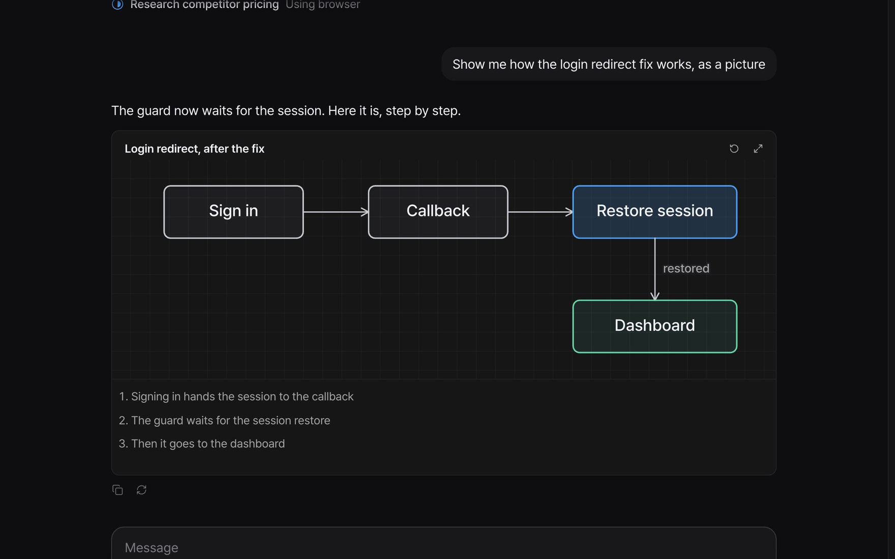</p>
<p align="center">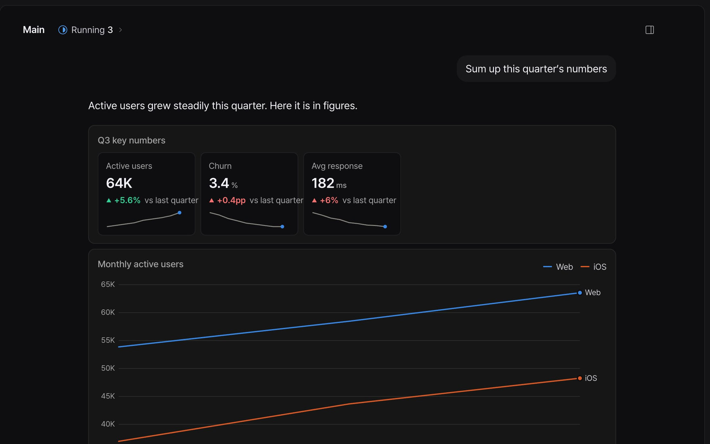</p>

</details>

## Your other Mac, right here

Connect another Mac once with a link, and its projects show up in your sidebar. Tasks there run with that Mac's files, tools and accounts; they show up here like any other task, and their questions come to you here. The Macs find each other on their own and talk end-to-end encrypted, directly when they can and through a relay when they can't. [How it works](docs/remote-control.md)

<p align="center"></p>

## And the rest

- **Memory:** decide once and it remembers. Answer the same question the same way and it stops asking; say a project rule twice and a task turns it into an automatic check, like a lint rule or a test. Keep preferences and lessons, or import existing notes; automatic saving can be turned off.
- **Routines:** daily work becomes a routine that runs on schedule while Ondra is open and the Mac is awake.
- **`/btw`:** ask a quick question on the side while the work runs, without interrupting it.
- **Pet:** a little pet that lives on your whole screen. It walks along the bottom and on top of other windows, falls when a window closes, can be picked up and thrown, and dozes off when nothing happens. It cheers when a task is done and calls you when one needs an answer. Type `/pet Pikachu` (any character) and a task finds (or draws) its GIFs and turns it into your pet.

<p align="center">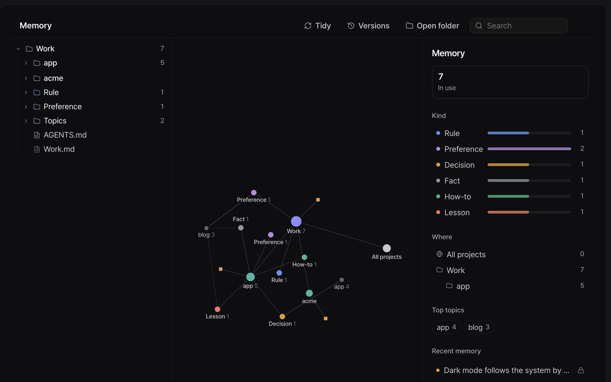</p>

<details>
<summary>A routine, made from the chat</summary>

<p align="center">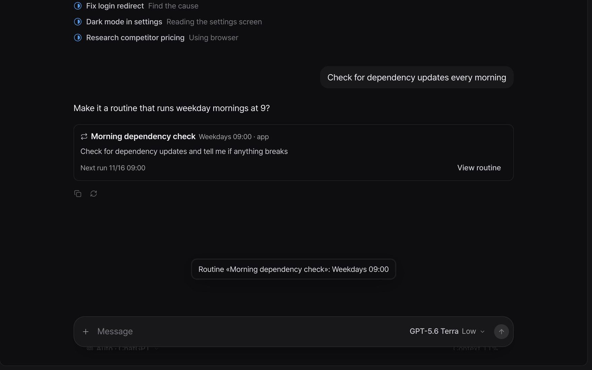</p>

</details>

<details>
<summary>Workspaces, settings and more</summary>

- **Workspaces:** create and name workspaces around the way you work. Each has its own accounts and instructions, and keeps its browser logins, memory and task history separate.
- **Settings:** choose your model, permissions (ask every time, auto: the AI lets safe steps through and asks about risky ones, or full) and concurrency. Per-task worktrees, automatic memory saving and PR review follow-up are configurable too.
- **Search and shortcuts:** find tasks, projects, memories and commands. Customize keyboard shortcuts in Settings.
- **Hooks:** configure shell commands at the points in a task's lifecycle where you need them.
- **Notifications:** enable system notifications to hear when work finishes or needs your attention.
- **Usage data:** optional anonymous telemetry can be disabled in Settings. See [what is sent](docs/TELEMETRY.md).

</details>

<details>
<summary>Tool access and boundaries</summary>

- Mac app actions need Accessibility permission; window capture needs Screen Recording. Foreground protection is configurable and is not an OS-level isolation environment.
- Mobile tasks create their own devices by default. They can also use an explicitly allowed existing device; protected devices are left alone.
- Bundled skills include browser use, computer use, device use, app check, deep research, code review, visual reports and web design. You can invoke one directly with `/skill:<name>`.

</details>

<br>

## Install

**macOS 13+ · Apple silicon**

1. Download `Ondra_<version>_aarch64.dmg` from the [latest release](https://github.com/3x-haust/ondra/releases) and drag Ondra into Applications.
2. Open Ondra and connect a model account, such as ChatGPT/Codex or Claude, in Settings.
3. Choose a project and say what you want done.

**Windows 10/11 x64:** run `Ondra_<version>_x64-setup.exe` from the same release. The installer isn't code-signed yet, so SmartScreen may ask first: **More info → Run anyway**.
**Linux x64:** install `Ondra_<version>_amd64.deb` (`sudo apt install ./Ondra_*.deb`) or `Ondra-<version>-1.x86_64.rpm` (`sudo dnf install ./Ondra-*.rpm`).

Ondra checks GitHub Releases and offers updates in the app, on every system. Mac app actions and capture need **Accessibility and Screen Recording** permissions. To work with mobile devices, install **Xcode's iOS Simulator** or the **Android SDK emulator**.

<details>
<summary>If macOS blocks the first launch</summary>

Confirm that the app came from [this repository's releases](https://github.com/3x-haust/ondra/releases), then right-click it in Finder and choose **Open**. If the quarantine attribute still blocks it, you can run the following once, only for a download you trust:

```sh
xattr -dr com.apple.quarantine /Applications/Ondra.app
```

</details>

<details>
<summary>Build from source</summary>

```sh
pnpm install
cp .env.example .env           # fill in the values you need
pnpm bundle                    # prepare tools, the agent engine and app components
pnpm tauri dev                 # run in development
pnpm release notes.md          # release build (see scripts/release.mjs)
```

- The agent engine comes from [3xhaustpi](https://github.com/3x-haust/3xhaustpi). Put it in a sibling folder or point `ONDRA_ENGINE_DIST` at `packages/coding-agent/dist`.
- The engine, Chrome and binary analyzer are components downloaded once per version. Updates use the app and any changed components; the DMG's app includes these components.
- Static binary analysis includes radare2, r2ghidra, native libraries and processor data, with no separate analysis engine to install. See [build and package checks](tools/binary-analysis/README.md).
- The browser tool (`ondra-browser`) and the computer-use helper (`ondra-cuhost`) are ours, written in Swift with no third-party code: `src-tauri/helpers/browser/` and `src-tauri/helpers/cuhost.swift`, built by `src-tauri/helpers/build.sh` (Xcode command line tools).

</details>

<details>
<summary>Local settings and repository layout</summary>

### Local settings (`.env`)

| Key | Meaning |
|---|---|
| `ONDRA_PROTECTED_DEVICES` | Devices no task may boot or operate (regex) |
| `ONDRA_DEVICES_ALLOWED` | Devices a task may use besides the ones it created |

Development builds read the repository's `.env`; the installed app reads `~/Library/Application Support/dev.3xhaust.ondra/.env`.

### Layout

```text
src/                 SolidJS UI
  engine/            main conversation and tasks, prompts, engine connection
  views/ ui/         screens and components
  styles/            design tokens
src-tauri/src/       Rust: engine process, browser, worktrees, keychain, devices
skills/              skills for tasks
extensions/          permissions, computer/device use, hooks, memory and other engine extensions
brand/ docs/         brand and documentation
```

</details>

---

<p align="center">
  <a href="https://github.com/3x-haust/ondra/releases">Releases</a> · <a href="docs/TELEMETRY.md">Telemetry</a> · <a href="https://github.com/3x-haust/ondra/issues">Report an issue</a> · <a href="LICENSE">MIT License</a>
</p>
<p align="center"><sub>Screens in this README and the film use sample data. The short animated clips are drawn in the app's design; the stills and the film are recorded from the app. The licenses of the open-source software Ondra includes are in the app: Settings › About › Open-source licenses.</sub></p>
